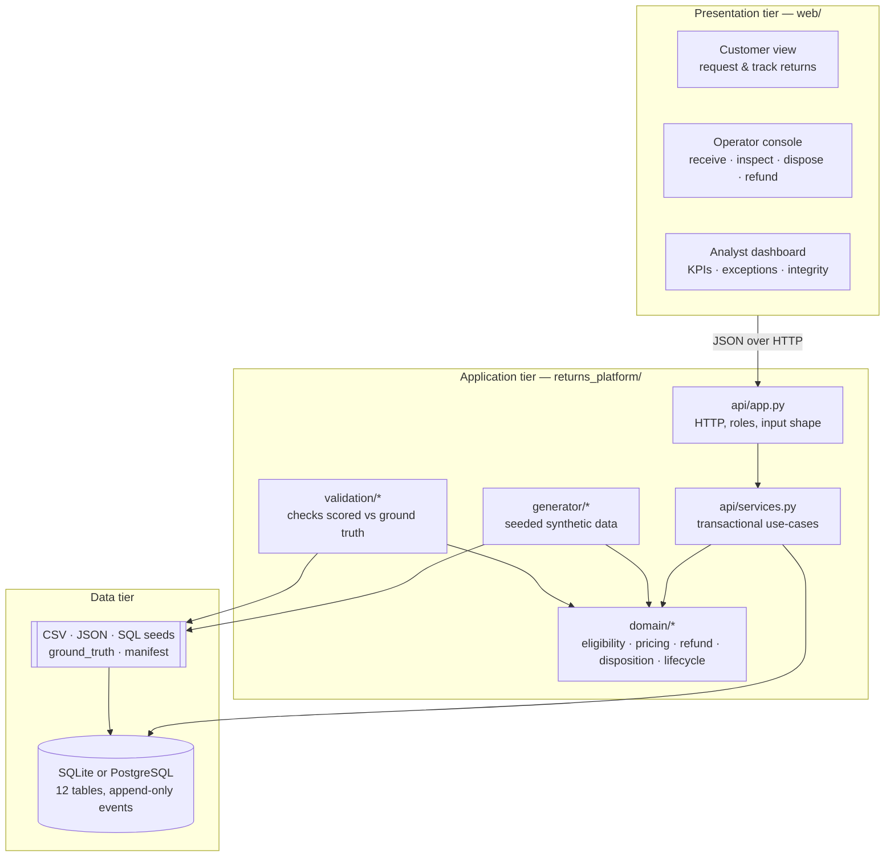
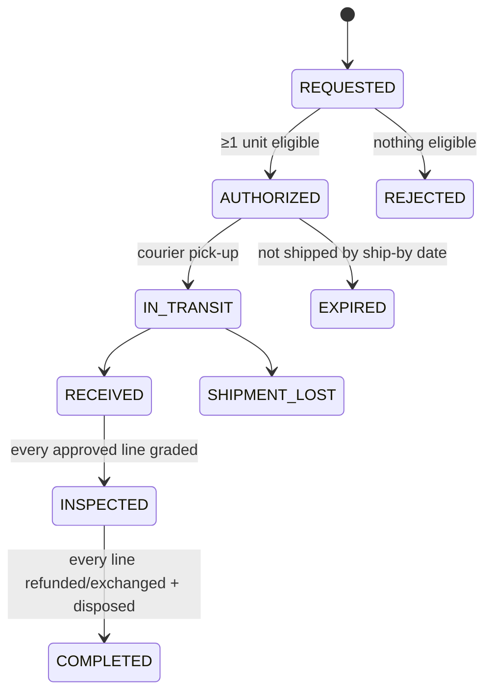

# Architecture

## Three tiers



**Rule of the build:** business rules live in exactly one place, `returns_platform/domain/`.
The API services, the data generator and the validators all call the same functions, so:

- generated outcomes are *produced by the rules*, never sampled as labels;
- validators *re-execute the rules* to check stored decisions;
- the live API cannot drift from the dataset's semantics.

| Tier | Owns | Never does |
|---|---|---|
| Presentation (`web/`) | layout, forms, showing decisions and reasons | compute eligibility, money or state |
| Application (`returns_platform/`) | policy decisions, state transitions, transactions, idempotency, roles | talk SQL outside `db.py` |
| Data (`db.py`, schema spec) | storage, PK/FK/unique/enum/range constraints, row locks | decide policy |

## Request lifecycle



Each transition is checked by `domain/lifecycle.py` and appended to `return_event`
(nothing is overwritten; `return_request.status` is a projection of the latest event, verified by
`lifecycle.event_paths`). Shipments have their own machine
(`LABEL_CREATED → IN_TRANSIT → RECEIVED | LOST`, `LABEL_CREATED → EXPIRED`).

## Decision rules (all in `config/return_policy.yaml`)

**Eligibility** — evaluated per line, in this order (first match wins, so the reported reason is deterministic):

1. `CATEGORY_EXCLUDED` — beauty, grocery, gift cards. *An override cannot bypass this.*
2. `WINDOW_EXPIRED` — days since delivery > category window (7–30 days), unless an operator override with reason + approver.
3. `NOTHING_RETURNABLE` — every purchased unit was already approved on earlier RMAs.
4. `QTY_EXCEEDS_RETURNABLE` — request clamped to `purchased − previously approved` → `PARTIALLY_APPROVED`.

**Refund** (`domain/refund.py`), integer paise throughout:

```
item   = slice(line.taxable)  × grade factor        slice = cumulative proportional share of the line
tax    = slice(line.tax)      × grade factor        (partial returns sum exactly to what was paid)
fees   = restocking (customer-fault only, category %) + return shipping (customer-fault only, ₹99, once per RMA, never below 0)
refund = item + tax − fees      and   Σ refunds on a line ≤ line_paid   (else RefundExceedsPaid)
```

Grade factors: A/B 100 %, C 80 %, D 50 %, E 100 %. Merchant-fault reasons (defective, wrong item,
not as described, arrived damaged) are always refunded at 100 % with no fees. Outbound shipping is never refunded.
COD orders are refunded as store credit.

**Duplicate-payout guard** — every refund call needs an `Idempotency-Key`:
same key → the stored result is returned (no new row); new key after a successful payout → a
`REJECTED_DUPLICATE` row is written (amount 0, `duplicate_of_refund_id` set); asking for more than
remains payable → `REJECTED_EXCEEDS_PAID`. On PostgreSQL the return line is locked `FOR UPDATE`, so two
concurrent calls cannot both pass the guard.

**Disposition** (`domain/disposition.py`) — requires an inspection; the grade and the category's
`refurbishable` flag decide RESTOCK / REFURBISH / QUARANTINE / SCRAP. Only RESTOCK increases sellable stock.

## Why the anomalies exist in the data if the system blocks them

The live system blocks all five issue types. The *dataset* still contains labelled instances of
them because it doubles as an evaluation set: it lets you prove the validators work (precision and
recall against `ground_truth/anomalies.csv`) and test downstream detectors. They model records arriving
from a legacy system or a bypassed path, and are marked rather than silently mixed in:
each anomaly touches one return line, has its original value recorded, and is caught by exactly one
documented rule.

## Key design decisions

| Decision | Why | Trade-off |
|---|---|---|
| One schema spec → DDL, dictionary, validators | docs and constraints can't drift | spec is Python, not a standard like JSON Schema |
| Integer paise, floor on refunds | exact reconciliation; rounding never overpays | customer may lose < ₹0.01 per partial line |
| Cumulative proportional slicing | any sequence of partial returns sums to the line total | slightly less intuitive than unit price × qty |
| Append-only events + status projection | full history, verifiable | status must be kept in sync (checked by a validator) |
| Per-stage SHA-256 seeded RNG streams | changing one stage (e.g. anomaly volume) doesn't reshuffle others | more seeds to reason about |
| Duplicate guard in the service (not a DB unique index) | the dataset can carry labelled duplicate payouts for evaluation | relies on the row lock on Postgres; SQLite serialises writes anyway |
| Snapshot clock (`as_of`) | realistic in-flight returns at the cut-off | demo server pins `RETURNS_CLOCK` just after the snapshot |
| Dependency-free web UI | runs anywhere FastAPI runs, no build step | less component structure than React |
| X-Role / X-Actor headers | keeps focus on the domain; one function to swap for OIDC/JWT | not real authentication |
